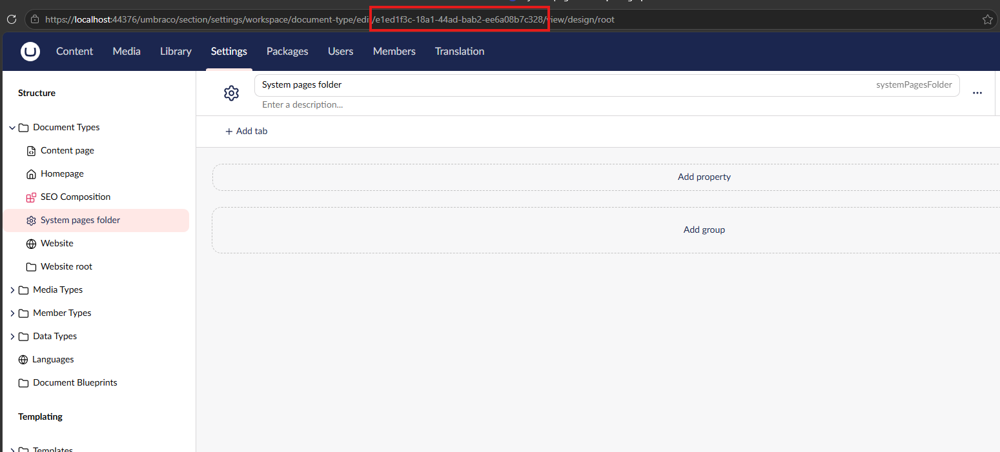
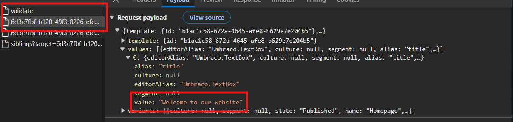

# Acceptance testing / End-to-end testing

This testing project demonstrates acceptance testing. When an application is deployed to a real environment, you can use acceptance testing to interact with your system as if you're a user and you can verify that your application responds how you expect.

| ℹ️ About commands |
|---|
| All commands are executed from the workspace root (The top-level folder where the license and TestingExample.slnx file are). Commands that are executed elsewhere are preceded with a `cd` command relative to the workspace root. |

## How to run the tests in this project
In order to run these tests, you need to host the website in a real environment. The easiest way to "host" the project is by simply starting the website in debug mode:

```
dotnet run --project .\src\TestingExample.Website\
```

When the website is running, you need to configure several settings. You need to log in to the backoffice and create an API user with client credentials. Make a note of the client id and client secret. This API User must have full access to the content tree, so give it at least the role of Editor. Create a file `./test/TestingExample.Website.FunctionalTests/packages/functional-tests/.env` with the following content:

```
WEBSITE_URL=https://localhost:44376/
WEBSITE_CLIENTID=INSERT CLIENT ID HERE
WEBSITE_CLIENTSECRET=INSERT CLIENT SECRET HERE

# This line is only required when you test against localhost
# It can be omitted when you test against a real hosted environment
NODE_TLS_REJECT_UNAUTHORIZED=0
```

You are now ready to run the tests. Use the following commands to run the end-to-end tests:

```
cd .\test\TestingExample.Website.FunctionalTests
pnpm install
pnpm --filter functional-tests test
```

| ⚠️ Loss of content! |
|---|
| These tests interact with the environment that you connect to. This includes deleting the entire content tree and reconstructing it for testing scenarios. Do not point these tests at a production environment or any other environment where the content is important! |

## Relevant source code

- [Example content model for constructing a content scenario](./packages/functional-tests/scenario/domain/homepage.ts)
- [Example test that tests a simple content scenario](./packages/functional-tests/tests/homepage.spec.ts)
- [Management API client generated with @hey-api/openapi-ts](./packages/scenario-builder/openapi-ts.config.ts)
- [Implementation of the scenario builder](./packages/scenario-builder/src/scenario/scenario.ts)

Notice that the scenario builder itself is also built with test-driven development with unit tests based on vitest.

## How it works
Each test prepares a scenario using the `ApiScenario`. This type acts as a simplified unit-of-work pattern to collect the content items that you want to create. You use this scenario to define how the content tree should look for your specific test. By calling the `.build()` method, this content tree definition is applied to your Umbraco website.

The `ApiScenario` works because Umbraco exposes a _Content Management API_ which has operations for creating and changing content in your application. The scenario has access to the content management api, because you created an API user in the backoffice.

## How to use
There is a decent amount of upfront work that you need to do to get started. All the steps are explained here in recommended order.

### Copy/paste the api client project
You need all the code in `packages/scenario-builder`. It contains all the base types that we need and it has the api client that connects to your Umbraco website. Copy and paste it into your own project. Make sure that you add the necessary dependencies in your test project so that you can import the `ApiScenario`.

### Define a minimal content tree
You should begin by defining your content types as models. [The system-pages model is a good example that you can use as a base](./packages/functional-tests/scenario/domain/system-pages.ts). The GUID in here is the content type key. You can find it in the backoffice in the URL bar when you edit the content type that you want to model:



The shape of the content tree depends a lot on how you define it. You should make the basic scenario as minimal as possible; what content is strictly necessary, in order to have a working application? For example: "For a minimal functional application, I need a root node, a homepage, a 404 page and at least one content page". Define empty content models for the content types that you need in this minimal scenario. In this case: "I need a website root type, a homepage type and a content page type".

You should then create your minimal content scenario using these content types. Just define the tree structure, avoid property values at this point. This will be your base scenario and you should create it in a function like this:

```typescript
type BasicScenario = {
  platform: Website;
  website: ContentRoot;
  homepage: Homepage;
  systemPages: SystemPages;
};

export function basicScenario(): { content: BasicScenario; scenario: Scenario } {
  const scenario = new ApiScenario();

  const platform = new Website(scenario);
  platform.hasVariation(Invariant, 'Test website');
  platform.isPublishedIn(Invariant);

  const systemPages = new SystemPages(scenario);
  systemPages.hasOrder(2);
  systemPages.hasParent(platform);
  systemPages.hasVariation(Invariant, 'System pages');
  systemPages.isPublishedIn(Invariant);

  const notFoundPage = new DetailPage(scenario);
  notFoundPage.hasParent(systemPages);
  notFoundPage.hasVariation(Invariant, '404 Page not found');
  notFoundPage.isPublishedIn(Invariant);

  const website = new ContentRoot(scenario);
  website.hasOrder(1);
  website.hasVariation(Invariant, 'website');
  website.hasParent(platform);
  website.hasDomain('en-US', new URL('https://localhost:44376'));
  website.isPublishedIn(Invariant);

  const homepage = new Homepage(scenario);
  homepage.hasParent(website);
  homepage.hasVariation(Invariant, 'Homepage');
  homepage.isPublishedIn(Invariant);

  return {
    content: {
      platform: platform,
      website: website,
      homepage: homepage,
      systemPages: systemPages,
    },
    scenario: scenario,
  };
}
```

It is wise to create a dummy test at this point to see if you can actually create the tree structure in Umbraco without any issues. You could make test like this:

```typescript
test.describe('basic scenario', () => {
  test('should be constructed in the backoffice', async ({ page }) => {
    
    const { content, scenario } = basicScenario();
    await scenario.build();

    throw Error('The outcome of this test is not relevant for now.');
  });
});
```

Run the test; do you see the content that you defined in the backoffice?

### Populate properties and publish
The next step is to populate your content items with property values. The best way to do this, is by adding functions to your models that reflect the structure of you content. For example: your homepage could have a title and an introduction, which together form a "header". In that case, define a function `.HasHeader( ... )` on your homepage content model:

```typescript
import { ContentPage, type Scenario, type Variation } from 'scenario-builder';

type HomepageHeader = {
  title?: string;
  description?: string;
};

export class Homepage extends ContentPage {
  constructor(scenario: Scenario) {
    super(scenario, 'f0cf962b-6398-477c-aa04-e4fbb4d69162');
  }
  public hasHeader(variation: Variation, header: HomepageHeader): Homepage {
    this.hasValue(variation, 'title', header.title);
    this.hasValue(variation, 'description', header.description);
    return this;
  }
}
```

The strings `'title'` and `'description'` are the aliasses of the fields that we want to populate. `variation` is the culture and segment for which you want to populate the fields.

If you need to know what the value is that you need to assign, the best way is to check what Umbraco sends over the network:



In this example, the title field receives a string value, so the value that you set in your model should also be a string value.

When your property values are configured, run your dummy test again. Is the content published? Does it have the properties that you configured? Can you visit the website and see the content in your browser?

You are now ready to simulate scenarios and run automated tests.